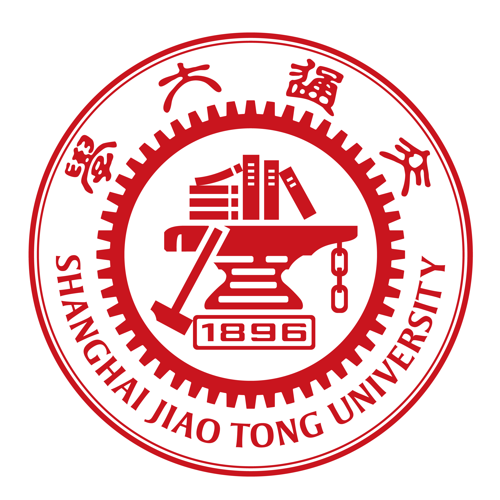

## Hi, I'm Kaiyang Xu (徐恺阳) 👋

CS Ph.D. student at [Shanghai Jiao Tong University](https://www.sjtu.edu.cn/) & Shanghai Innovation Institute, RL2 Lab, advised by [Prof. Yue Gao](https://gaoyue.sjtu.edu.cn/).
I work on robot learning and reinforcement learning, especially humanoid locomotion and whole-body control.
For research discussions or collaborations, feel free to contact me at passerby_zzz(at)sjtu.edu.cn.

  
  &nbsp;&nbsp;&nbsp;&nbsp;
  
  &nbsp;&nbsp;&nbsp;&nbsp;
  

